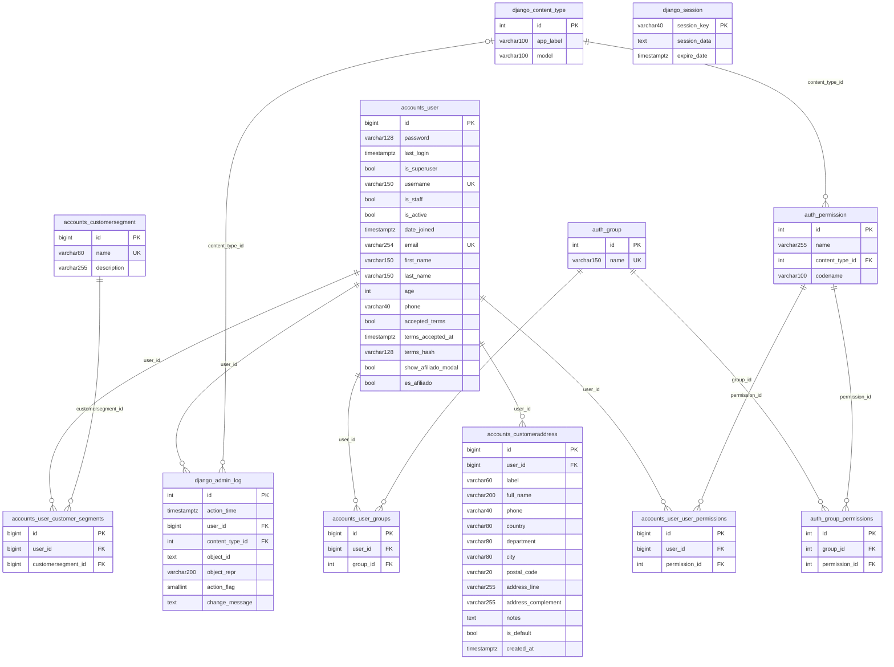
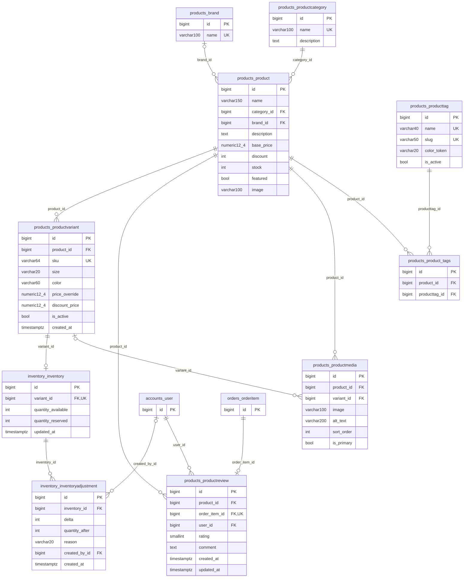
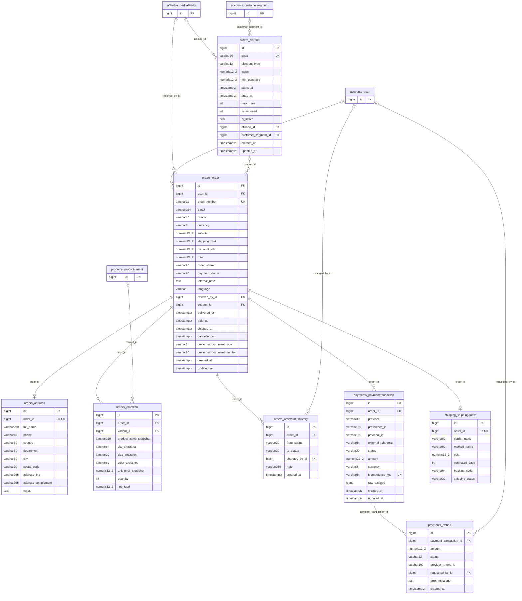
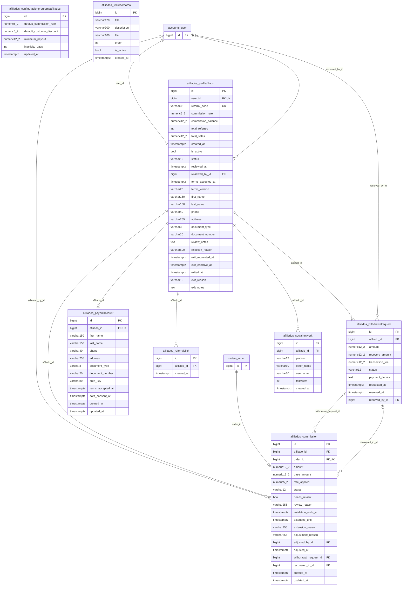
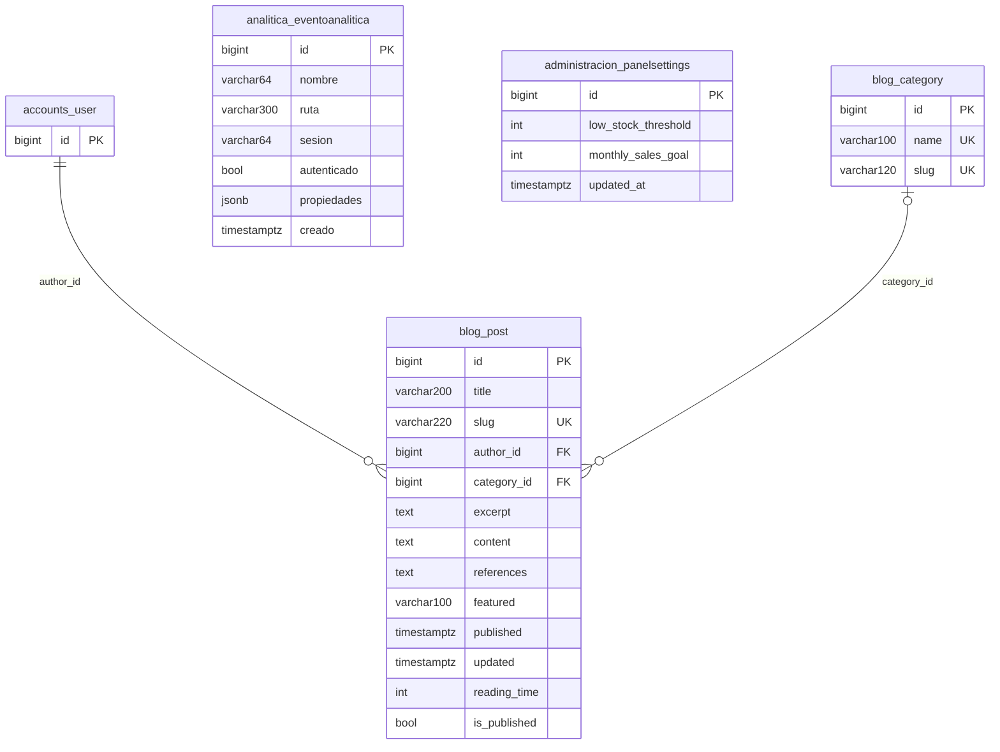

# Diagrama de la base de datos

Diagramas entidad-relación (Mermaid) de GoToGym Prime, generados desde los modelos de Django con `python Temp/generar_diagrama_bd.py`. No editar a mano: volver a generar cuando cambien los modelos.

## De dónde sale y qué tan "real" es

- **Fuente:** los modelos y las 86 migraciones del repositorio (42 tablas, sin contar la tabla de caché `django_cache` que crea `migrate`). Es exactamente el esquema que `migrate` construye en PostgreSQL, incluidas las tablas intermedias de las relaciones muchos-a-muchos.
- **Contraste con producción (15-oct-2026):** en una restauración del respaldo de `psql-gotogym-prod` (punto en el tiempo del 15-oct, 20:51 hora de Colombia) la base `gotogym_prime` tenía **44 tablas y 80 migraciones aplicadas**, la última el 10-oct. Las diferencias conocidas con el código de aquel momento: `django_cache` (la crea `migrate`, no es un modelo), dos tablas que no se identificaron (probablemente restos de la base "influencer" original que adapta una migración; no se consultaron sus nombres) y la migración `orders 0011` (columna `Order.language`, 15-oct), que pudo no estar aplicada en esa copia. Las migraciones posteriores (restricciones, índices, historial de estados) no están aplicadas en producción hasta el siguiente despliegue.
- **Límite:** este documento no se generó leyendo el catálogo de la base viva (el servidor de producción solo acepta conexiones desde Azure y no se abrió su firewall). Para confirmarlo columna por columna, ejecutar `python manage.py inspectdb` o `\d+` con `psql` desde el App Service.
- Notación: `PK` clave primaria, `FK` clave foránea, `UK` única. `||--o{` es uno a muchos obligatorio; `|o--o{`, uno a muchos con la clave foránea opcional (nula); `||--o|`, uno a uno. Los tipos son los de PostgreSQL abreviados (`varchar150` = `varchar(150)`, `numeric12_2` = `numeric(12,2)`).

## Vista general (solo relaciones)

```mermaid
erDiagram
    accounts_customeraddress
    accounts_user ||--o{ accounts_customeraddress : "user_id"
    accounts_customersegment
    accounts_user
    accounts_user_customer_segments
    accounts_user ||--o{ accounts_user_customer_segments : "user_id"
    accounts_customersegment ||--o{ accounts_user_customer_segments : "customersegment_id"
    accounts_user_groups
    accounts_user ||--o{ accounts_user_groups : "user_id"
    auth_group ||--o{ accounts_user_groups : "group_id"
    accounts_user_user_permissions
    accounts_user ||--o{ accounts_user_user_permissions : "user_id"
    auth_permission ||--o{ accounts_user_user_permissions : "permission_id"
    auth_group
    auth_group_permissions
    auth_group ||--o{ auth_group_permissions : "group_id"
    auth_permission ||--o{ auth_group_permissions : "permission_id"
    auth_permission
    django_content_type ||--o{ auth_permission : "content_type_id"
    django_content_type
    django_session
    django_admin_log
    accounts_user ||--o{ django_admin_log : "user_id"
    django_content_type |o--o{ django_admin_log : "content_type_id"
    products_brand
    products_product
    products_productcategory ||--o{ products_product : "category_id"
    products_brand |o--o{ products_product : "brand_id"
    products_product_tags
    products_product ||--o{ products_product_tags : "product_id"
    products_producttag ||--o{ products_product_tags : "producttag_id"
    products_productcategory
    products_productmedia
    products_product ||--o{ products_productmedia : "product_id"
    products_productvariant |o--o{ products_productmedia : "variant_id"
    products_productreview
    products_product ||--o{ products_productreview : "product_id"
    orders_orderitem ||--o| products_productreview : "order_item_id"
    accounts_user ||--o{ products_productreview : "user_id"
    products_producttag
    products_productvariant
    products_product ||--o{ products_productvariant : "product_id"
    inventory_inventory
    products_productvariant ||--o| inventory_inventory : "variant_id"
    inventory_inventoryadjustment
    inventory_inventory ||--o{ inventory_inventoryadjustment : "inventory_id"
    accounts_user |o--o{ inventory_inventoryadjustment : "created_by_id"
    orders_address
    orders_order ||--o| orders_address : "order_id"
    orders_coupon
    afiliados_perfilafiliado |o--o{ orders_coupon : "afiliado_id"
    accounts_customersegment |o--o{ orders_coupon : "customer_segment_id"
    orders_order
    accounts_user |o--o{ orders_order : "user_id"
    afiliados_perfilafiliado |o--o{ orders_order : "referred_by_id"
    orders_coupon |o--o{ orders_order : "coupon_id"
    orders_orderitem
    orders_order ||--o{ orders_orderitem : "order_id"
    products_productvariant |o--o{ orders_orderitem : "variant_id"
    orders_orderstatushistory
    orders_order ||--o{ orders_orderstatushistory : "order_id"
    accounts_user |o--o{ orders_orderstatushistory : "changed_by_id"
    payments_paymenttransaction
    orders_order ||--o{ payments_paymenttransaction : "order_id"
    payments_refund
    payments_paymenttransaction ||--o{ payments_refund : "payment_transaction_id"
    accounts_user |o--o{ payments_refund : "requested_by_id"
    shipping_shippingquote
    orders_order ||--o| shipping_shippingquote : "order_id"
    afiliados_commission
    afiliados_perfilafiliado ||--o{ afiliados_commission : "afiliado_id"
    orders_order ||--o| afiliados_commission : "order_id"
    accounts_user |o--o{ afiliados_commission : "adjusted_by_id"
    afiliados_withdrawalrequest |o--o{ afiliados_commission : "withdrawal_request_id"
    afiliados_withdrawalrequest |o--o{ afiliados_commission : "recovered_in_id"
    afiliados_configuracionprogramaafiliados
    afiliados_payoutaccount
    afiliados_perfilafiliado ||--o| afiliados_payoutaccount : "afiliado_id"
    afiliados_perfilafiliado
    accounts_user ||--o| afiliados_perfilafiliado : "user_id"
    accounts_user |o--o{ afiliados_perfilafiliado : "reviewed_by_id"
    afiliados_recursomarca
    afiliados_referralclick
    afiliados_perfilafiliado ||--o{ afiliados_referralclick : "afiliado_id"
    afiliados_socialnetwork
    afiliados_perfilafiliado ||--o{ afiliados_socialnetwork : "afiliado_id"
    afiliados_withdrawalrequest
    afiliados_perfilafiliado ||--o{ afiliados_withdrawalrequest : "afiliado_id"
    accounts_user |o--o{ afiliados_withdrawalrequest : "resolved_by_id"
    blog_category
    blog_post
    accounts_user ||--o{ blog_post : "author_id"
    blog_category |o--o{ blog_post : "category_id"
    analitica_eventoanalitica
    administracion_panelsettings
```

## Cuentas y acceso

Aplicaciones: `accounts`, `auth`, `contenttypes`, `sessions`, `admin`.

## Catálogo e inventario

Aplicaciones: `products`, `inventory`.

## Pedidos, pagos y envíos

Aplicaciones: `orders`, `payments`, `shipping`.

## Programa de afiliados

Aplicaciones: `afiliados`.

## Contenido, analítica y panel

Aplicaciones: `blog`, `analitica`, `administracion`.

## Inventario de tablas

| Tabla | Modelo | Columnas | Relaciones salientes |
|---|---|---|---|
| `accounts_customeraddress` | accounts.CustomerAddress | 14 | accounts_user |
| `accounts_customersegment` | accounts.CustomerSegment | 3 | — |
| `accounts_user` | accounts.User | 18 | — |
| `accounts_user_customer_segments` | accounts.User_customer_segments | 3 | accounts_customersegment, accounts_user |
| `accounts_user_groups` | accounts.User_groups | 3 | accounts_user, auth_group |
| `accounts_user_user_permissions` | accounts.User_user_permissions | 3 | accounts_user, auth_permission |
| `auth_group` | auth.Group | 2 | — |
| `auth_group_permissions` | auth.Group_permissions | 3 | auth_group, auth_permission |
| `auth_permission` | auth.Permission | 4 | django_content_type |
| `django_content_type` | contenttypes.ContentType | 3 | — |
| `django_session` | sessions.Session | 3 | — |
| `django_admin_log` | admin.LogEntry | 8 | accounts_user, django_content_type |
| `products_brand` | products.Brand | 2 | — |
| `products_product` | products.Product | 10 | products_brand, products_productcategory |
| `products_product_tags` | products.Product_tags | 3 | products_product, products_producttag |
| `products_productcategory` | products.ProductCategory | 3 | — |
| `products_productmedia` | products.ProductMedia | 7 | products_product, products_productvariant |
| `products_productreview` | products.ProductReview | 8 | accounts_user, orders_orderitem, products_product |
| `products_producttag` | products.ProductTag | 5 | — |
| `products_productvariant` | products.ProductVariant | 9 | products_product |
| `inventory_inventory` | inventory.Inventory | 5 | products_productvariant |
| `inventory_inventoryadjustment` | inventory.InventoryAdjustment | 7 | accounts_user, inventory_inventory |
| `orders_address` | orders.Address | 11 | orders_order |
| `orders_coupon` | orders.Coupon | 14 | accounts_customersegment, afiliados_perfilafiliado |
| `orders_order` | orders.Order | 24 | accounts_user, afiliados_perfilafiliado, orders_coupon |
| `orders_orderitem` | orders.OrderItem | 10 | orders_order, products_productvariant |
| `orders_orderstatushistory` | orders.OrderStatusHistory | 7 | accounts_user, orders_order |
| `payments_paymenttransaction` | payments.PaymentTransaction | 13 | orders_order |
| `payments_refund` | payments.Refund | 8 | accounts_user, payments_paymenttransaction |
| `shipping_shippingquote` | shipping.ShippingQuote | 8 | orders_order |
| `afiliados_commission` | afiliados.Commission | 19 | accounts_user, afiliados_perfilafiliado, afiliados_withdrawalrequest, orders_order |
| `afiliados_configuracionprogramaafiliados` | afiliados.ConfiguracionProgramaAfiliados | 6 | — |
| `afiliados_payoutaccount` | afiliados.PayoutAccount | 13 | afiliados_perfilafiliado |
| `afiliados_perfilafiliado` | afiliados.PerfilAfiliado | 27 | accounts_user |
| `afiliados_recursomarca` | afiliados.RecursoMarca | 7 | — |
| `afiliados_referralclick` | afiliados.ReferralClick | 3 | afiliados_perfilafiliado |
| `afiliados_socialnetwork` | afiliados.SocialNetwork | 7 | afiliados_perfilafiliado |
| `afiliados_withdrawalrequest` | afiliados.WithdrawalRequest | 10 | accounts_user, afiliados_perfilafiliado |
| `blog_category` | blog.Category | 3 | — |
| `blog_post` | blog.Post | 13 | accounts_user, blog_category |
| `analitica_eventoanalitica` | analitica.EventoAnalitica | 7 | — |
| `administracion_panelsettings` | administracion.PanelSettings | 4 | — |
